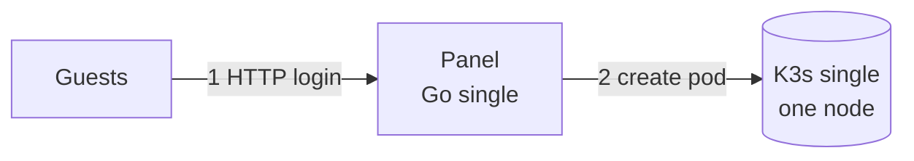
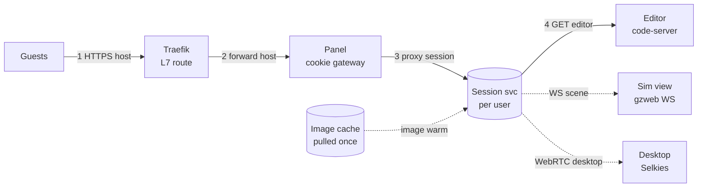
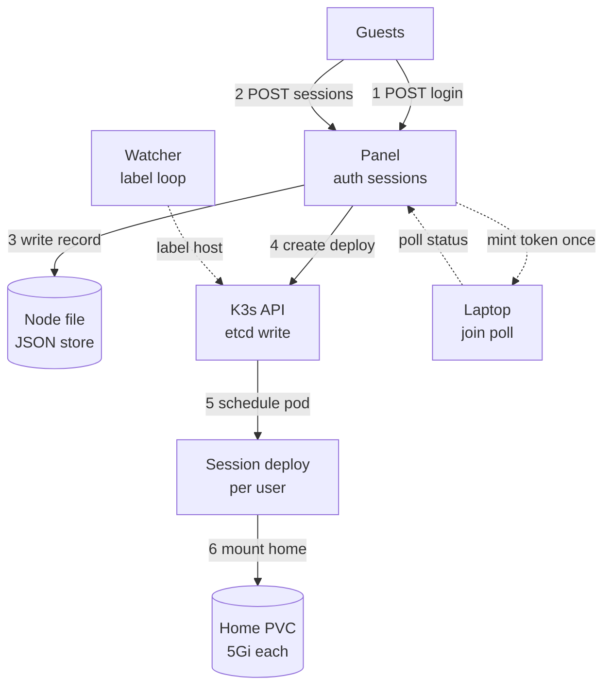
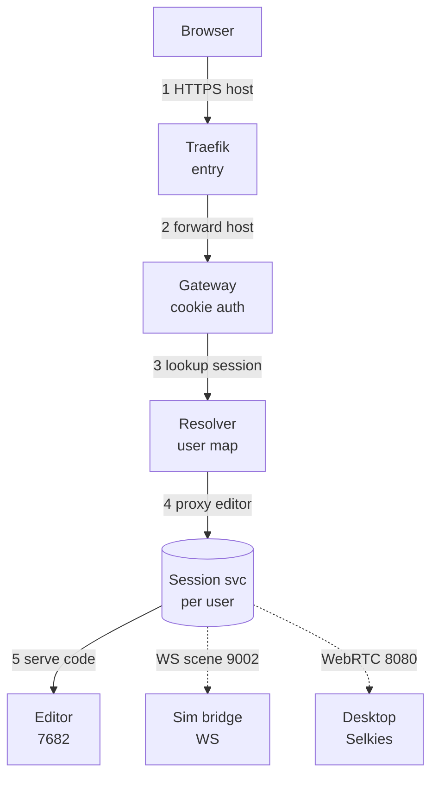
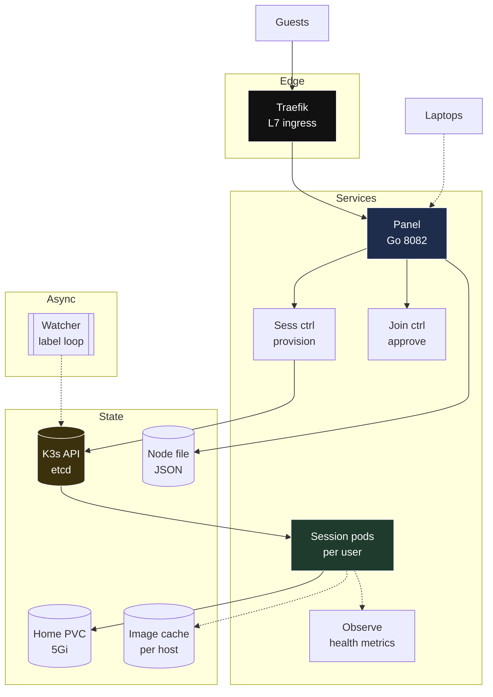

# Design: LDNDRC Workshop Cluster — full HLD + LLD (staged, agnostic)
# DONT TAKE ACTION ON THIS (its only for future)
- Slice: `--full`
- Scope line: design LDNDRC for local workshops at 100–150 users, strong session ownership and isolation / eventual sim freshness.
- > Archetype: hybrid: transactional core + live fan-out — because session create and host approve need exact once-per-user state, while update rate times fan-out for Gazebo scene plus Selkies desktop dominates bandwidth and freshness SLO (service-level objective: the promise you measure yourself against).

## Step 0 — Assumptions (FR / NFR / out-of-scope)

One-sentence restatement: you run browser-only robotics labs on laptops you already own, with one isolated ROS (Robot Operating System: robotics middleware for topics and nodes) workspace per student.

| Question | Assumption (prefix `Assumption:` if unconfirmed) | Why it drives the design |
|---|---|---|
| FR (functional requirements: what the system does, verb-first) | 1. Log in and launch a personal session 2. Code and drive sim from browser tabs 3. Register and approve host laptops 4. Tear down sessions on demand | Names the journey the design lives or dies by; every box traces to launch, use, join, or cleanup |
| Scale horizon | `Assumption:` 150 DAU (daily active users: distinct people in one day) for one workshop day, 1 session per user, peak factor 3.0 at start-of-class, no growth needed | Decides host count, PVC (persistent volume claim: reserved disk per session) total, and LAN (local area network: your room network, not the internet) bandwidth |
| Read:write + payload | `Assumption:` control-plane 30 actions/user/day at ~2KB each; streaming ~5 Mbps per active sim; home data 5Gi per session; retention 2 days | Splits tiny control reads and writes from heavy live streams |
| Latency / availability | `Assumption:` p99 (99th-percentile latency: the near-worst case almost every request beats) login under 1s, session ready under 90s, editor keystroke echo under 200ms on LAN, sim scene under 500ms; 99.0% session launch success during workshop | Bans wide-area tiers from hot paths; sets degrade bar to stale or shared sim over error |
| Consistency / durability | Strong per-user session ownership and unique ROS_DOMAIN_ID (ROS domain id: number isolating one robot network from another); eventual sim scene and desktop frames; RPO (recovery point objective: how much recent data you can afford to lose) 1 session record on panel crash without PVC loss | Splits exact session registry from best-effort pixels |
| Out-of-scope (3–5) | 1. Internet-scale multi-region 2. Real credential directory and billing 3. Full-text search over code or docs 4. Long-term artifact archive beyond workshop 5.Zero-touch OS provisioning of laptops | Deferred with forcing condition: revisit when workshops repeat weekly, when audit needs real identity, when corpus exceeds trivial filters, when retention exceeds 2 days, when fleet exceeds 30 hosts |

Scope method follows `requirements-scoping` (scope capture: turn vague prompt into FR plus NFR plus out-of-scope): three lists plus revisable `Assumption:` lines, no silent facts. You state the guesses now so you can argue with them later.

## Step 1 — Naive v1 + mermaid #1 (≤3 nodes, archetype-shaped)

Archetype: hybrid, so v1 is the cheapest correct control loop: browser talks to one Go (Go language: compiled single-binary backend) panel, panel creates one pod on one K3s (lightweight Kubernetes: cluster manager for containers on laptops) node. You feel the real shape early: correctness lives in session ownership, cost lives in streams.

- Why starting simple is correct: (a) one panel plus K3s API (application programming interface: exact request plus response contract) satisfies FR-1 and FR-4 with local transactions and no distribution tax; (b) control-plane QPS (queries per second: requests arriving each second) is near zero, so no cache, queue, or shard earns its keep yet; (c) BOTEC (back-of-the-envelope calculation: rough sizing math that decides the shape) host math becomes the baseline before you add ingress, gateway hosts, or GPU (graphics processing unit: chip that renders sim and video) slicing.
- Deliberately deferred: Traefik ingress until second host or hostname routing is needed; cookie gateway hosts until browser tabs need per-user routing; GPU time-slicing until real Harmonic image lands; session file persistence until first restart orphan; LAN DNS (domain name system: name to address lookup) until `/etc/hosts` (local hostname file: manual name mapping on each laptop) stops scaling.

## Step 2 — BOTEC break-table (only chains that can change a decision)

Formulas: `QPS_avg = DAU × actions/day ÷ 86,400`; `QPS_peak = avg × peak_factor`; `storage/day = writes/day × bytes`; `total = storage/day × retention`; `bandwidth = QPS × payload` plus stream rate times viewers; `servers ≈ peak ÷ per-server_QPS` (RDBMS (relational database: tables with joins and transactions) ~1k, KV (key-value store: get and put by key only) ~10k, cache ~100k–1M per `back-of-the-envelope` (sizing math: turn vague scale into QPS plus storage plus servers)). Exact control check via `skills/back-of-the-envelope/scripts/botec.py`. Every row shows inputs with units. You size the room, not the internet.

| Load | Math (inputs + units) | Verdict (breaks what / forces what) |
|---|---|---|
| Control avg QPS | 150 DAU × 30 actions/user/day ÷ 86,400 s/day = 4,500 ÷ 86,400 ≈ 0.05 QPS avg | Confirms v1 panel holds; no cache or replica forced |
| Control peak QPS | 0.05 QPS × 3.0 peak_factor = 0.16 QPS peak, burst ~150 creates over 120 s = 1.25 creates/s (`botec.py --dau 150 --actions 30 --peak 3` → avg 0 / peak 0, storage 9.0MB/day) | Forces K3s API burst handling, not panel scale; single Go binary at 50m–250m CPU (central processing unit: compute cores) is enough |
| Session concurrency | 150 users × 1 session/user = 150 concurrent pods | Breaks single host; forces bin-pack scheduler plus admission queue |
| Hosts by CPU | 150 pods × 3.5 CPU avg = 525 CPU cores ÷ 10 allocatable cores/host = 52.5 → 53 Hosts | Deciding verdict V-cpu: 150 full sims need ~53 gaming laptops; 12-Host workshop caps at ~36 full sims |
| Hosts by RAM | 150 pods × 6Gi avg = 900Gi ÷ 28Gi allocatable/host = 32.1 → 33 Hosts | RAM (main memory: fast workspace holding running pods) is kinder than CPU, but CPU still decides |
| Hosts by GPU slice | 150 pods × 1 slice ÷ 4 slices/GPU = 37.5 → 38 GPUs, so 38 Hosts | GPU time-slicing helps, CPU still binds first; demo-standin with `SESSION_GPU_LIMIT=0` removes this row |
| Home storage total | 150 sessions × 5Gi/session = 750Gi live | Forces per-host local provisioner spread plus cleanup on DELETE; fits 15 Hosts × 100Gi spare, fails on 5 Hosts |
| Workspace image bytes | `Assumption:` 10GB image × 15 Hosts = 150GB one-time pull, cached per host | Forces pre-pull night before; cold pull storm on class start saturates LAN |
| Live egress per user | `Assumption:` 3 Mbps desktop + 1.5 Mbps scene + 0.1 Mbps editor = 4.6 Mbps/user | Sets per-user freshness budget; Wi-Fi (wireless LAN: shared radio link) cell breaks before wire does |
| LAN aggregate | 150 users × 4.6 Mbps = 690 Mbps sustained | Forces wired master plus multiple 5 GHz cells; single consumer AP (access point: radio box serving Wi-Fi clients) melts |
| K3s object writes | 150 sessions × 3 objects = 450 objects over 120 s = 3.75 writes/s | Fits single etcd (consistent store: majority-agree metadata log for cluster state) on master; no shard forced |

Conclusion: V-cpu and 690 Mbps force admission control plus wired LAN plus image pre-warm; control QPS and etcd writes confirm v1 panel and single-master K3s hold. Skipped: cross-region bandwidth and multi-year retention, CDN (content delivery network: edge cache for static files) offload, and per-row TX (transaction: all-or-nothing multi-step commit) analysis — YAGNI (you aren't gonna need it: do not build what no number demands) for a 2-day LAN room with no cloud named.

## Step 3 — API / interface contracts (LLD surface)

Per `api-design` (contract design: exact shapes plus retries plus pagination plus errors): REST (representational state transfer: resource URLs with JSON over HTTP) plus JSON (JavaScript object notation: text record format) default, verbs by retry safety, cursor only where lists grow, stable error envelope, no version in code yet so use `/api` with additive fields. Your contract is what browsers and laptops actually marry.

- `POST /api/auth/login` `{"username":"bob","password":"secret123"}` → 200 `{"token":"JWT","expires_in":86400}` plus `Set-Cookie: session=...; Domain=.ros-platform.local; HttpOnly` — retry-safe read of credential check today. Serves FR-1. Rationale: cookie carries gateway auth across four hosts without per-tab tokens.
- `POST /api/sessions` `Authorization: Bearer JWT` → 202 `{"id":"ses_abc","status":"provisioning"}` — non-idempotent create, so clients send `Idempotency-Key: uuid` (client-sent dedupe token: same token returns stored answer). Serves FR-1. Rationale: start-of-class double-clicks must not mint two pods.
- `GET /api/sessions` → 200 `{"data":[...],"next_cursor":null}` with cursor over creation time — cacheable for 5s in panel memory. Serves FR-2. Rationale: polling storms collapse to cheap reads.
- `GET /api/sessions/{id}` → 200 `{"id":"...","status":"ready","node":"host-7","hosts":{"editor":"...","desktop":"...","gazebo":"..."}}` / 404 unknown. Serves FR-2. Rationale: gateway routes only on `ready`, else 503 with `Retry-After: 5`.
- `DELETE /api/sessions/{id}` → 202 `{"status":"stopping"}` — naturally idempotent delete. Serves FR-4. Rationale: safe to retry cleanup without orphan risk.
- `POST /api/nodes/register` `{"hostname":"laptop-a","cpu":12,"ram_gb":32,"gpu":"NVIDIA RTX"}` → 200 `{"id":"node_x","status":"pending"}` with rate limit 5/min/IP — unauthenticated by design. Serves FR-3. Rationale: join must work before trust exists; `JOIN_KEY` (pre-shared join secret: password laptops present to register) gates abuse.
- `GET /api/nodes/{id}` → 200 `{"status":"approved","k3s_url":"https://192.168.1.50:6443","k3s_token":"K10...","node_name":"ldndrc-<id>"}` — poll every 5s, token minted once. Serves FR-3. Rationale: one-time token prevents replay joins.
- `POST /api/nodes/{id}/approve` and `/deny` with operator JWT → 200 `{"status":"approved"}` / 403 forbidden. Serves FR-3. Rationale: human gate matches workshop trust.
- `GET /healthz` → 200 `{"status":"ok"}` shallow, plus `GET /readyz` checking K3s reachability. Rationale: liveness never fails on slow K3s, readiness does.
- `WS /ws/{session}` upgraded WebSocket (persistent two-way socket: long-lived channel for live updates) proxy with cookie auth — reconnect with jitter (randomized delay spread: avoids synchronized retries). Serves FR-2. Rationale: editor, gzweb, and Selkies share one auth front door.
- Errors: `{error:{code,message,request_id,retryable}}` plus `429 + Retry-After` on register flood, `401` missing cookie, `404` no session, `503` provisioning, `502` pod unhealthy. Versioning: additive fields only; reserve `/v1` when student UI (user interface: browser app) pins a contract.

## Step 4 — Evolved reads HLD + mermaid #2 (≤10 nodes; Step-2 read verdict forces it)

Verdicts forcing reads: 690 Mbps aggregate plus per-user 4.6 Mbps plus image 10GB pull storm. Principle first: streams should never touch the panel twice, and bytes should stay on the room wire.

Per added component — **Why / Without-it / Change-when**:

- Traefik L7 route — Why: host-based `editor/desktop/gazebo/control` split serves 150 browsers from one LAN address per V-lan. Without-it: path prefixes leak across users and sticky affinity breaks. Change-when: single Traefik CPU exceeds 70% for 5 min → add second entrypoint on another master. Uses `load-balancing` (traffic spread: L4 versus L7 plus health plus affinity): L7 for host routing, least-connections for long WebSockets, slow-start on recovered pods.
- Cookie gateway in panel — Why: one HttpOnly cookie authenticates all four subdomains to the correct per-user Service per FR-2. Without-it: each tool needs its own login and tab-switch drops auth. Change-when: gateway p99 exceeds 100ms → move host match to Traefik middleware with shared JWT (JSON web token: signed login stamp) verifier.
- Session Service per user — Why: isolates RSVP per student so one crash does not reroute 149 others. Without-it: shared Service plus ClientIP affinity pins strangers together and scales down badly. Change-when: Services exceed 500 objects → switch to single gateway map plus ClusterIP (internal service address: stable virtual IP inside cluster) per pod.
- Image cache per host — Why: 10GB times 150 pulls would replay 1.5TB over LAN; pull-once holds it to 150GB. Without-it: class start stampedes the registry and sessions stay `provisioning`. Change-when: disk pressure exceeds 80% → add registry mirror on master plus `ImagePullPolicy: IfNotPresent`. Uses `blob-store` (large-object storage: immutable bytes by key with durability tiers): images are immutable blobs, panel stores only pointer plus tag.
- Editor versus stream split — Why: code-server stays sync request-response while Selkies and gzweb stay async push, matching their freshness budgets. Without-it: polling the scene at 30 Hz multiplies control QPS 100-fold. Change-when: scene Hz times viewers exceeds AP budget → drop to 10 Hz plus delta frames. Uses `content-delivery` (edge bytes: push static close to users): deferred as internet CDN, applied as LAN pre-warm plus pull-once.

## Step 5 — Evolved writes HLD + mermaid #3 (≤10 nodes; write and coupling verdict forces it)

Verdict forcing writes: 150 concurrent Deployments plus PVC mounts plus one-time join tokens. Principle first: keep the money path — your session record — synchronous and exact, push everything else to poll and retry.

Per added component — **Why / Without-it / Change-when**:

- JSON file store for nodes plus sessions — Why: survives panel container restart without running a database for 150 rows. Without-it: every restart orphans live Deployments as seen in CP09 and CP11. Change-when: writes exceed 50/s or two panel replicas appear → move to SQLite (light file database: single-file relational store) then Postgres, with reconcile on boot. Uses `data-storage` (record home: pick SQL versus NoSQL plus keys plus replication): single-file relational wins until write QPS or multi-writer forces it.
- K3s API plus etcd single master — Why: 3.75 writes/s fits one Raft (consensus protocol: majority agrees on one log) majority with zero operator cost. Without-it: external DB adds a second SPOF (single point of failure: one box whose loss stops a core flow) you cannot fix in a classroom. Change-when: master loss exceeds 10 min tolerance → add standby master plus `etcd` snapshot to USB. Uses `consistency-coordination` (agree rules: what readers see during lag or partition): single-leader writes, local reads, fail closed on partition.
- Per-session Deployment plus Service plus PVC — Why: gives independent lifecycle, stable DNS name, and 5Gi home per FR-1 and FR-4. Without-it: StatefulSet (ordered pod set: numbered pods with sticky identity) ordinals couple ROS_DOMAIN_ID to replica count and block heterogeneous hosts. Change-when: object count exceeds 1,000 → template with deterministic `ROS_DOMAIN_ID = 100 + hash mod 200`. Uses `sequencer` (id mint: unique sortable ids without central bottleneck): ULID (time-sortable id: timestamp plus random, sorts by creation) for session ids today, ordinal math only as fallback.
- Join poll plus one-time token — Why: laptops behind NAT (network address translation: shared-IP fixup hiding devices) cannot receive callbacks, but they can poll every 5s. Without-it: push webhook never reaches the laptop. Change-when: fleet exceeds 200 pollers or 5s staleness hurts → switch to long-poll plus server-sent hints. Uses `task-scheduling` (when plus who runs it: leases plus retries plus fairness): join is a leased task with visibility timeout plus DLQ (dead-letter queue: parking lot for repeatedly failing messages) on bad hardware reports.
- 5s label watcher — Why: marks `Ready` nodes `role=host` so session scheduler lands pods only on qualified laptops. Without-it: pods pend on the master or weak Guests. Change-when: watch lag exceeds 15s → move label to join-time admission webhook. Uses `messaging-streaming` (async transport: queue versus stream plus DLQ): applied as poll plus file, stream deferred because no replay or fan-out need exists.

## Step 6 — LLD deep-dive + mermaid #4 (≤10 nodes, one subsystem only)

Target: gateway fan-out plus per-user routing — the tightest latency SLO and the first place 150 browsers collide.

- Hot-path walk with per-hop protocol plus payload bytes. You click `editor.ros-platform.local` → TLS (transport layer security: encrypted HTTP wrapper) to Traefik in ~2ms on wire, host match in ~1ms, gateway cookie verify with JWT secret in ~1ms, in-memory session map lookup `user → ClusterIP:7682` in microseconds, ReverseProxy GET to code-server with ~2KB headers plus ~50KB page, editor WebSocket for keystrokes at ~200 bytes per event. Scene path: gzweb WS (WebSocket: persistent two-way channel) subscribes at 30 Hz, each JSON frame `Assumption:` 5–50KB → 1.5 Mbps typical. Desktop path: Selkies WebRTC (real-time media: low-delay video over UDP) negotiates once, then 2–5 Mbps video, no per-frame panel cost. Panel stays out of media bytes after proxy handshake where possible.
- Key, index, TTL, and partition table. `sessions.json: key session_id ULID → {user, status, service_name, node, ROS_DOMAIN_ID, created_at}` with in-memory index on `user → session_id` and TTL (time to live: auto-expire timer) 2 days plus tombstone on DELETE. `nodes.json: key node_id → {hostname, cpu, ram_gb, gpu, status, k3s_token_issued_bool}` with index on `status`. Gateway session cookie 24h HttpOnly, `COOKIE_DOMAIN=.ros-platform.local`, CSRF (cross-site request forgery: evil site reusing your cookie) token per R3. K3s Service name `sess-<shortid>` is the partition key: all three tool hosts resolve to one ClusterIP, so affinity is by name, not by client IP.
- Failure injection: kill each box and state user-visible degrade plus recovery. Traefik down → all tabs fail; degrade to direct `panelIP:8082` emergency list; recover by restarting static binary, clients retry with jitter. Gateway slow → 503 with `Retry-After: 5`; degrade to cached `ready` map for GETs, fail closed for POSTs; recover with half-open probe plus slow-start. Session pod crash → editor 502, scene freezes; degrade to `provisioning` page plus auto-recreate from PVC; recover with exponential backoff plus jitter, max 3 restarts then `stopped`. Master etcd stall → creates queue; degrade to read-only use of running sessions; recover by compaction plus snapshot, drain join polls first. Uses `resilience-failure` (stay-up tricks: timeouts plus breakers plus degrade): every remote call gets timeout at p99 plus breaker plus explicit stale-or-closed choice.
- Bottleneck metric plus signal threshold. Watch gateway p99 above 100ms for 5 min, Traefik active WebSockets above 400 per instance, per-Host CPU above 85% for 10 min, and session `provisioning → ready` p90 above 90s. Any one firing means the room, not the code, is full.

## Step 7 — Final topology + mermaid #5 (≤14 nodes, topology only)

No rationale on arrows. Full detail lives in Steps 4–6 and §8–§10.

## 8. Data model / structures

Stores: `sessions.json` plus `nodes.json` on `emptyDir` today, PVC per session for home, K3s etcd for desired state. You keep the registry tiny and the bytes where they belong.

- Session record: `session_id ULID`, `user`, `status: provisioning | ready | stopping | stopped`, `service_name sess-<short>`, `node`, `ROS_DOMAIN_ID int 100–250`, `created_at`, `idempotency_key` 24h. Rationale: ULID sorts by time for cursor polls; idempotency key makes start-of-class retries safe. Index per hot query: `user → session_id` for gateway, `status → list` for admin.
- Node record: `node_id`, `hostname`, `cpu`, `ram_gb`, `gpu string`, `status: pending | approved | joined | denied`, `k3s_token_issued bool`, `created_at`. Rationale: one-time token flag stops double-mint. Index: `status`.
- Home PVC: `pvc-sess-<short>`, 5Gi, `ReadWriteOnce`, retained until DELETE plus 2-day TTL sweeper. Rationale: code survives pod crash, not semester. Uses `data-storage`: file plus PVC wins at 150 rows; no shard key needed.
- K3s objects per session: Deployment plus Service, labels `app=ldndrc-session`, `session=<id>`, `user=<hash>`. Rationale: label selector is the gateway resolver without extra DB hop.
- TTLs and retention: session cookie 24h, CSRF token per login, idempotency keys 24h, gateway negative cache 5s for `provisioning`, metrics 7 days local, logs 2 days hot then drop. Image tags immutable (`:jazzy-harmonic-<sha>`), never `:latest` for sessions.

## 9. Key decisions & trade-offs

| Decision | Solves (cite FR/NFR/verdict) | Worsens (non-empty, blocking) | Change it when (breaking point) |
|---|---|---|---|
| Single-master K3s on operator laptop | Solves FR-1 at 3.75 writes/s and zero extra hardware | Worsens master SPOF: sleep, death, or Wi-Fi drop freezes creates | Change when workshop exceeds 1 day or master loss tolerance under 10 min → standby master plus snapshot |
| Per-session Deployment plus Service plus PVC | Solves FR-1 isolation and FR-4 cleanup at 150 concurrency | Worsens object sprawl: 450 objects plus scheduler pressure at start spike | Change when objects exceed 1,000 or ready p90 exceeds 90s → pool plus reuse plus quota |
| Host hostnames plus LAN hosts file first | Solves FR-2 today with zero DNS ops | Worsens onboarding toil: 150 edits plus stale entries plus `.local` collisions | Change when setup time exceeds 30 min or second room appears → LAN DNS with 60s TTL |
| Cookie gateway in Go panel | Solves FR-2 single login across 4 hosts | Worsens panel blast radius: gateway bug or CPU stall hits all tabs | Change when gateway p99 exceeds 100ms for 5 min → split gateway Deployment with 2 replicas |
| Time-sliced single GPU times 4 | Solves sim for 4 users per GPU per V-gpu | Worsens frame jitter under contention: 4 sims share one encoder | Change when scene p99 exceeds 500ms or encoder above 90% → cap 2 per GPU or add Hosts |
| JSON file store, reconcile on boot | Solves restart orphans at 150 rows | Worsens crash window: last write before fsync can vanish | Change when writes exceed 50/s or 2 panels run → SQLite then Postgres |
| Pre-pull 10GB image night before | Solves 150GB pull storm per V-image | Worsens disk: 10GB pinned per Host plus slow first cache | Change when disk above 80% or image weekly → registry mirror on master |
| Wired master plus multi-cell Wi-Fi | Solves 690 Mbps aggregate per V-lan | Worsens setup cost: cables, switches, channel plan | Change when sustained egress exceeds 800 Mbps or loss above 1% → cap active sims plus 10 Hz scene |

## 10. Failure modes & degradation

| Failure | User sees | Degrade path | Recovery (no stampede) |
|---|---|---|---|
| Master laptop sleeps or dies | Creates hang, running sims keep rendering briefly | Fail closed for creates, fail open for running pods; show read-only banner | Wake plus K3s restart, snapshot restore if etcd corrupt, staggered re-poll with jitter |
| Host laptop closes lid | Its 3 sessions freeze | Reschedule to spare Host from PVC, show `provisioning` with queue position | K3s NotReady after ~40s, evict plus reschedule, image already warm, slow-start gateway |
| GPU encoder saturated | Scene stutters, desktop lags | Drop scene to 10 Hz, prefer editor over pixels, show `degraded: true` | Shed lowest-priority sim, half-open re-admit one per 30s |
| Traefik overload | Tabs 502 or WS drops | Direct panel IP emergency page plus session list | Add second entrypoint, drain plus slow-start, jittered client reconnect |
| Panel restart | In-memory map empty | Serve from reloaded JSON plus K3s reconcile; creates 503 for 30s | Reconcile adopt-or-tombstone, warm gateway cache, cap creates at 2/s for 2 min |
| Join token replay | Second laptop denied | Fail closed with `already-minted`, operator re-approves manually | Rotate `K3S_JOIN_URL` token, audit nodes file |
| PVC full | Save fails with clear error | Quota 5Gi hard, show cleanup hint, keep sim running | Delete caches plus old bags, expand to 10Gi only on spare Hosts |
| LAN AP collapse | All streams buffer | Freeze scene, keep editor text, switch one cell to 5 GHz only | Move master to wire, halve active sims, staged rejoin per table |

## 11. Scale evolution (10× / 100×)

Current bottleneck plus signals: CPU bin-pack at ~3 full sims per Host and 690 Mbps LAN; signals are pending pods above 10 for 5 min, Host CPU above 85%, gateway ready p90 above 90s, Traefik WS above 400. Uses `scaling-evolution` (growth ladder: single box to tiers to replicas to cache to stateless to shard): climb one rung when a number crosses, not before. You live happily at replicated Hosts plus pre-warmed images; sharding and multi-region never appear here.

What changes at 10× (1,500 users): single room dies — split into cells of 40 users per master with separate `/etc/hosts` or LAN DNS zone, registry mirror per cell, session TTL 4h plus aggressive DELETE sweeper, panel 2 replicas with shared SQLite on master USB, admission queue with visible position. Metric says time: pending above 30 or LAN above 800 Mbps for 10 min.

What changes at 100× (15,000 users): LAN model dies — move to building backbone with 10 Gbps, dedicated registry plus image CDN mirror, K3s to multi-master or hosted control, session store to Postgres with read replica, per-tenant quota plus fair-share scheduler. Metric says time: etcd write p99 above 500ms or PVC provision above 2 min. Never claim perfection: weakest dimension today is Host churn tolerance — one lid-close still migrates 3 users with visible freeze.

## 12. Open questions + validation

Open: confirm 150 truly concurrent full sims or waves of 40; confirm Host count and GPU models on hand; confirm wired switch available; deferred per archetype with one line each — media blobs: container images via `blob-store`, no user video store; IDs: ULID plus ROS_DOMAIN_ID via `sequencer`, no Snowflake needed; search: `distributed-search` deferred, corpus under 1k files so DB filter wins; logs: `distributed-logging` minimal file plus `kubectl logs`, no ELK at 150 users; SLOs: `observability` (measure what matters: RED plus USE plus burn alerts) with `/healthz` plus `/readyz` plus gateway p99, full Prometheus deferred to R7; jobs: `task-scheduling` as session lease plus sweeper, no Airflow; counters: `sharded-counters` deferred, hottest count under 10/s so single atomic wins; queue: `messaging-streaming` deferred to poll plus file; cache: `caching` (hot-copy tricks: TTL plus herd guards) deferred for control reads, scene deltas only if AP melts; `dns` (name front door: records plus TTL plus failover) as hosts file now, 60s LAN zone at second room; `load-balancing` health plus slow-start as above; `service-decomposition` (service cuts: monolith versus gateway versus workers) stays modular panel until gateway p99 forces split; `consistency-coordination` single-leader as above.

- [ ] Every §9 row has non-empty Worsens + breaking point.
- [ ] Every number carries inputs + units; skipped chains justified (YAGNI).
- [ ] Every component traces to an FR, NFR, or Step-2 verdict (else deleted).
- [ ] Every critical dependency has a degrade path (not just "retry"); money paths fail closed.
- [ ] Mermaid caps hold (10 / 10 / 10 / 10 / 14); arrows numbered sync solid, async dashed.
- [ ] Coverage sweep: media / IDs / search / logs / SLOs / jobs / counters addressed or explicitly deferred.
- [ ] No managed-service names/quotas unless user named a cloud (then "verify against current docs").
- [ ] Weakest dimension + current bottleneck + next-magnitude change stated; never claims perfection.
